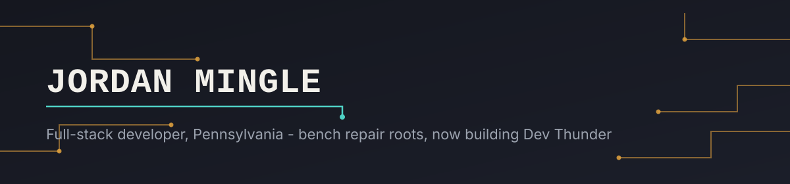
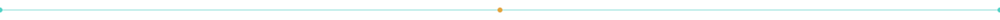

Full-stack developer in Pennsylvania. I've been building on the web since 2017: solo freelance, team-based development, and now running my own company, **Dev Thunder**.

I specialize in **Ruby on Rails** and **SvelteKit** with **TypeScript**, build custom **WordPress** plugins and themes, and style with **CSS / Tailwind / Sass**. Nearly two decades of hands-on technical work, from hardware repair to 13+ client and product projects delivered end to end, with a focus on performance, accessibility, and clean APIs.

<p align="left">
  
  
  
  
  
  <br/>
  
  
  
  
  
</p>



### 🔧 What I work on

```
$ bench --readout

[OK]  Rails & APIs        ActiveRecord, background jobs, auth
[OK]  Svelte / SvelteKit  Type-safe fullstack apps, TypeScript
[OK]  UI & styling        Accessible CSS, Tailwind, Sass
[OK]  WordPress           Custom plugins, themes, long-term client sites
[OK]  Infrastructure      Domains, hosting, SSL, deploy pipeline
```


### 🛠️ How I got here

1. **2008 - Freelance IT repair**: 150+ computer hardware and IT repairs, explaining each fault in plain terms.
2. **2014 - Eastside Computer**: retail and bench work: triage, diagnostics, parts sourcing.
3. **2017 - Jordan Mingle Web Designs**: went solo as an independent freelancer, owning each project from scoping to delivery.
4. **2018 - My Domain Labs**: team-based web development: client sites, hosting, domains, SSL, deploys.
5. **2021 - Dev Thunder**: founded my own company, now building toward combined hosting + development.


### 📊 GitHub stats

<div align="center">
  
  
</div>

<div align="center">
  
</div>


### 🚀 Featured projects

<table>
<tr>
<td width="33%" valign="top">

**[Rizzo CSS](https://rizzo-css.vercel.app/)**

My own CSS design system: 58 accessibility-first components (WCAG AA), 14 OKLCH themes, and a CLI. Published on npm.

`CSS` `PostCSS` `OKLCH`

[GitHub](https://github.com/mingleusa/rizzo-css) · [npm](https://www.npmjs.com/package/rizzo-css)

</td>
<td width="33%" valign="top">

**[Mazzullo's](https://mazzullos.com/)**

WordPress site for an auto detailing shop, maintained since 2017.

`WordPress` `Long-term maintenance`

</td>
<td width="33%" valign="top">

**[Gunopoly](https://gunopoly.com/)**

A classifieds marketplace and forum with location filtering.

`Rails` `Hotwire` `Tailwind`

</td>
</tr>
</table>


### 🏢 Dev Thunder

`[●] status: building - full-stack dev now, hosting coming online`

My own company: full-stack development for local clients across north-central Pennsylvania, expanding toward a combined web hosting and development offering.


### 📫 Get in touch

<p align="left">
  <a href="mailto:hello@jordanmingle.dev"></a>
  <a href="https://www.linkedin.com/in/jordanmingle/"></a>
</p>
